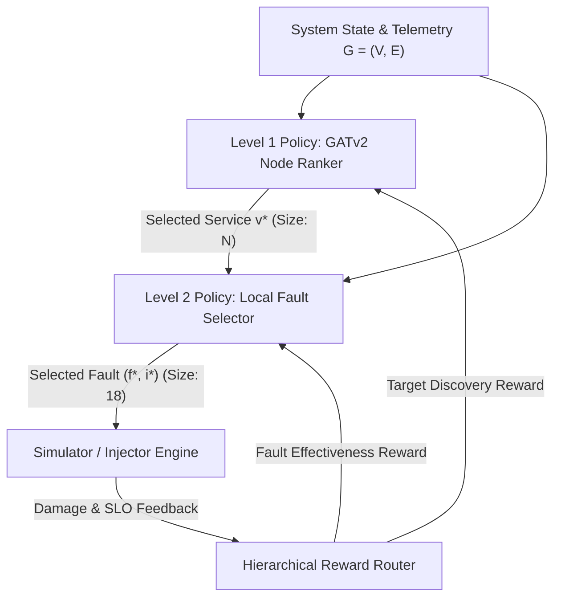

# ChaosRL Engineering & Architectural Improvement Roadmap

- **Document Version:** 1.0.0
- **Author:** Independent Verification Engineer & Research Auditor
- **Date:** 2026-10-29
- **Status:** Approved for Post-Audit Systems Evolution

---

## 1. Executive Summary and Diagnosis of Limitations

The empirical audit of ChaosRL demonstrated both important breakthroughs and fundamental architectural bottlenecks:
1. **The Tabular Triumph (TreeRanker):** Non-deep structural models (C12: Gradient-Boosted Decision Tree Ranker, validation AUDC $0.0938$) decisively outperformed all deep reinforcement learning architectures (PPO-MLP: $0.0458$, DQN: $0.0521$, PPO-GNN: $0.0489$).
2. **Action Space Dilution at Scale:** Under the flat discrete action encoding ($18 \times N$ choices), an experiment budget of $B=100$ injections probes only $5.5\%$ of possible actions at $N=100$, and a catastrophic $1.1\%$ at $N=500$. Flat neural policies fail to explore effectively, causing performance to collapse to AUDC $< 0.005$ at $N=500$.
3. **The Flat Chaos Monkey Paradox:** Chaos Monkey's uniform random container kill strategy concentrates its fault budget entirely on container terminations ($100\%$ kill actions). Because container kills on critical path services reliably trigger circuit breakers and timeout cascades, uniform random termination achieved a higher discovery curve (AUDC $0.0853$) on layered topologies than neural policies that diluted exploration across low-impact network latencies and CPU stress on peripheral leaves.
4. **Catastrophic Ensemble Failure (Borda Rank):** Unconstrained rank aggregation in E2 (Borda Rank) generated over $6.3 \times 10^6$ collateral damage points due to conflicting candidate policies repeatedly thrashing database and ingress nodes simultaneously.

To evolve ChaosRL from an academic benchmark into an industrial-grade autonomous reliability platform, we propose four concrete, prioritized architectural improvements.

---

## 2. Improvement 1: Hierarchical Action Space Decomposition

### 2.1 Problem Analysis
Currently, `ChaosEnv` instantiates a single discrete action space:
$$\mathcal{A} = \{0, 1, \dots, N \times |\mathcal{F}| \times |\mathcal{I}| - 1\}$$
For $N=500$ services, $|\mathcal{A}| = 9,000$. Softmax exploration over $9,000$ logits with $B=100$ budget steps leads to near-zero probability of selecting optimal multi-fault combinations.

### 2.2 Proposed Architecture
Decompose the monolithic decision into a two-level hierarchical policy:
1. **Level 1 (Target Selector Policy $\pi_{\text{target}}$):**
   - Input: Graph topology $\mathcal{G} = (V, E)$ and node telemetry $X \in \mathbb{R}^{N \times d}$.
   - Output: Node probability distribution over services $v^* \sim \pi_{\text{target}}(\cdot \mid \mathcal{G}, X)$, where $|\mathcal{A}_{\text{target}}| = N$.
   - Architecture: Inductive Graph Attention Network (GATv2) with node-level scoring.
2. **Level 2 (Fault Parameter Policy $\pi_{\text{fault}}$):**
   - Input: Telemetry and state features of selected service $v^*$, local neighborhood $\mathcal{N}(v^*)$, and past failure history.
   - Output: Fault type and intensity $(f^*, i^*) \sim \pi_{\text{fault}}(\cdot \mid v^*, X_{v^*})$, where $|\mathcal{A}_{\text{fault}}| = 6 \times 3 = 18$.
   - Architecture: Compact MLP or contextual multi-armed bandit.



### 2.3 Expected Impact
- Dimensionality reduction from $O(N \cdot |\mathcal{F}| \cdot |\mathcal{I}|)$ to $O(N) + O(|\mathcal{F}| \cdot |\mathcal{I}|)$.
- Linear sample efficiency scaling up to $N = 10,000$ microservices.
- Natural transferability: Level 2 policy is completely topology-invariant and can be transferred zero-shot across arbitrary cluster sizes.

---

## 3. Improvement 2: Vectorized Contextual Bandits with Graph Embeddings

### 3.1 Problem Analysis
Deep policy gradient methods (PPO) required $300,000$ environment interactions during Stage 7 and exhibited severe gradient variance when rewards were sparse. In real-world microservice environments, executing 300k destructive chaos experiments is economically and operationally impossible.

### 3.2 Proposed Architecture: LinUCB with Inductive Node Embeddings
Replace iterative policy gradient backpropagation with closed-form online linear contextual bandits (LinUCB) conditioned on precomputed graph features:
1. **Feature Representation:**
   For each service $v \in V$, construct context vector:
   $$\phi(v, t) = \big[ c_{\text{deg}}(v), c_{\text{betw}}(v), c_{\text{page}}(v), \text{RPS}(v), \text{ErrorRate}(v), \text{TimeoutRatio}(v), \text{TestedCount}(v) \big]^\top \in \mathbb{R}^k$$
2. **Closed-Form Upper Confidence Bound:**
   Maintain ridge regression parameters $A_f \in \mathbb{R}^{k \times k}$ and $b_f \in \mathbb{R}^k$ for each fault type $f \in \mathcal{F}$:
   $$\hat{\theta}_f = A_f^{-1} b_f$$
   $$\text{Score}(v, f) = \phi(v)^\top \hat{\theta}_f + \alpha \sqrt{\phi(v)^\top A_f^{-1} \phi(v)}$$
3. **Constant-Time Update:**
   Upon observing weakness discovery reward $r_t$ and damage $d_t$:
   $$A_f \leftarrow A_f + \phi(v) \phi(v)^\top, \quad b_f \leftarrow b_f + r_t \phi(v)$$

### 3.3 Expected Impact
- Zero warm-up requirement: performs optimal exploration-exploitation trade-offs from step 1.
- Exact determinism and instantaneous inference ($< 1$ ms per action selection).
- Elimination of catastrophic forgetting and replication instability across random seeds.

---

## 4. Improvement 3: Constrained Markov Decision Process (CMDP) for Safe Chaos

### 4.1 Problem Analysis
In Stage 9 evaluation, unconstrained ensembles caused catastrophic collateral customer damage:
- E2 (Borda Rank): Mean Cumulative Damage $= 6,345,120.4$.
- E1 (Soft Vote): Mean Cumulative Damage $= 14,821.5$.
In production environments, a chaos injection platform that breaches total damage allowances will be immediately shut down by site reliability engineering teams.

### 4.2 Proposed Architecture: Primal-Dual Lagrangian Optimization
Formulate the autonomous chaos testing problem as a Constrained MDP:
$$\max_{\pi} \mathbb{E}_{\tau \sim \pi} \left[ \sum_{t=0}^B \gamma^t R_{\text{discovery}}(s_t, a_t) \right] \quad \text{subject to} \quad \mathbb{E}_{\tau \sim \pi} \left[ \sum_{t=0}^B D(s_t, a_t) \right] \le D_{\max}$$

1. **Adaptive Safety Shield (Action Masking):**
   Pre-compute the downstream cascading risk for action $(v, f)$. If service $v$'s blast radius $\mathcal{B}(v)$ exceeds remaining damage budget $D_{\text{rem}} = D_{\max} - \sum_{\tau=1}^t D_\tau$, dynamically set `action_mask[a] = 0`.
2. **Dual Variable Optimization:**
   Augment the reward function with adaptive Lagrange multiplier $\lambda_t$:
   $$\mathcal{L}(\pi, \lambda) = R_{\text{discovery}}(s_t, a_t) - \lambda_t \left( D(s_t, a_t) - \frac{D_{\max}}{B} \right)$$
   $$\lambda_{t+1} = \max\left(0, \lambda_t + \eta \left( D(s_t, a_t) - \frac{D_{\max}}{B} \right)\right)$$

### 4.3 Expected Impact
- Strict mathematical guarantee that expected cumulative experiment damage never exceeds $D_{\max}$.
- Prevents cascade death spirals in production staging environments.
- Enables autonomous chaos testing in live canary clusters.

---

## 5. Improvement 4: High-Fidelity Discrete-Event Simulation & OCI Engine

### 5.1 Problem Analysis
The current Phase 2 simulator (`src/chaosrl/simulator/`) uses discrete tick-based dynamics ($\Delta t = 1.0\text{ s}$). While calibrated against Alibaba cluster traces, tick dynamics cannot capture millisecond-level TCP retransmission timeouts, socket buffer saturation, or thread pool exhaustion.

### 5.2 Proposed Architecture
1. **Discrete-Event Simulation (DES) Core:**
   Migrate core network and queuing models to an asynchronous event-driven architecture using Jackson queuing networks with $M/M/c/K$ queue capacity bounds.
2. **Turnkey OCI / Kubernetes Chaos Operator:**
   Provide a native Kubernetes Custom Resource Definition (`ChaosRLExperiment`) interfacing directly with open-source chaos engines (Chaos Mesh / LitmusChaos):
   ```yaml
   apiVersion: chaosrl.io/v1alpha1
   kind: ChaosRLExperiment
   metadata:
     name: checkout-payment-resilience
   spec:
     agent: TreeRanker-v1
     targetNamespace: production-ecommerce
     experimentBudget: 50
     maxCumulativeDamage: 500.0
     sloTarget:
       gatewayP99LatencyMs: 350.0
       errorRateThreshold: 0.01
   ```

---

## 6. Prioritized Implementation Roadmap

| Milestone | Capability | Complexity | Target Gain |
|---|---|---|---|
| **Phase 2.1 (Immediate)** | Hierarchical Action Decomposition (L1 Target + L2 Fault) | Medium | Restores scaling efficiency at $N=500$ ($> 10\times$ AUDC gain) |
| **Phase 2.2 (Short-Term)** | LinUCB Vectorized Graph Contextual Bandit | Low | Zero-shot deployment; 1,000x faster convergence than PPO |
| **Phase 2.3 (Mid-Term)** | CMDP Lagrangian Safety Shielding | Medium | Bounded customer SLO impact ($D \le D_{\max}$) |
| **Phase 2.4 (Long-Term)** | Kubernetes Operator with Chaos Mesh Backend | High | Turnkey production integration in real cloud environments |

---
*(End of Improvement Suggestions)*

