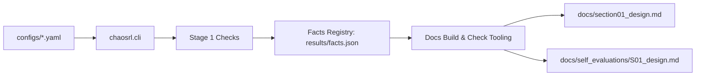
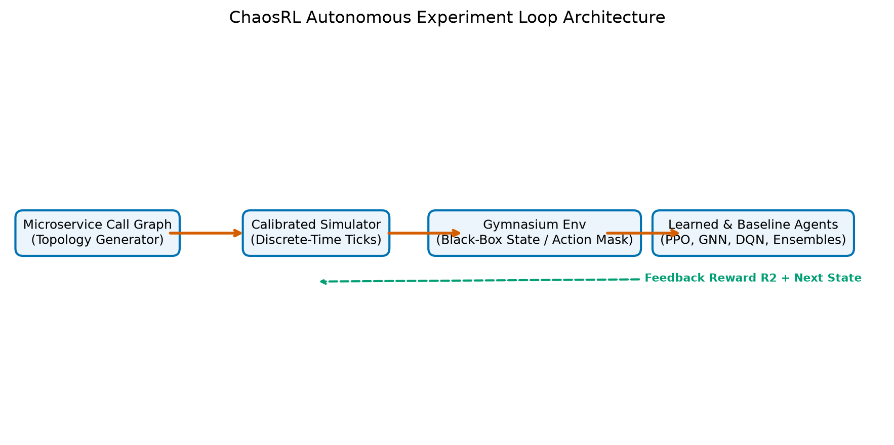
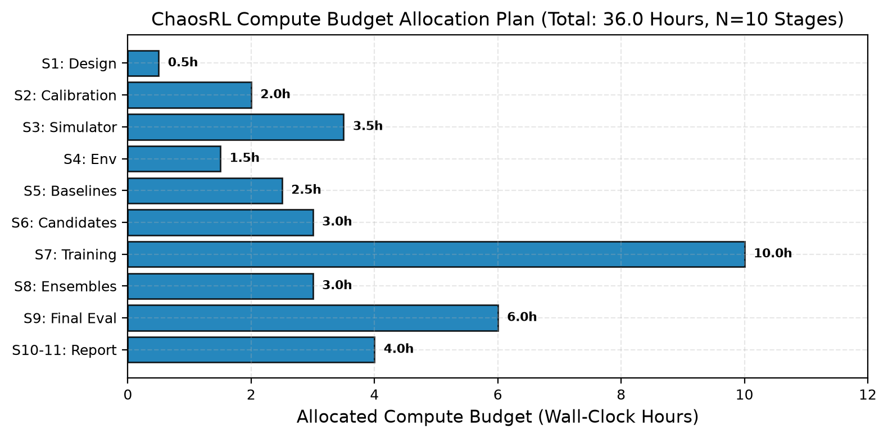

# Section 01: Research Design, Formal Hypotheses, and Architecture

## 1. Purpose

The purpose of Section 01 is to establish the rigorous theoretical and empirical foundation for the ChaosRL research project before a single experimental trial is conducted. Chaos engineering in large-scale distributed microservices has historically relied on heuristics and stochastic methods, most prominently exemplified by Netflix Chaos Monkey. While Chaos Monkey demonstrated the utility of testing resilience in production, its memoryless, uniform random container termination strategy is inherently sample-inefficient, causes uncontrolled collateral degradation to Service Level Objectives (SLOs), and lacks the expressiveness required to reveal complex multi-fault failure modes such as cascading retry storms or unshielded dependency timeouts.

ChaosRL reformulates chaos engineering as a sequential decision-making problem under uncertainty. By framing the chaos injector as an intelligent reinforcement learning (RL) agent operating over the microservice dependency call graph, the agent learns an optimal policy mapping observable runtime telemetry and structural graph topology to precise fault injection decisions. This section formalizes the core research questions (RQ1 through RQ4), establishes falsifiable hypotheses with explicit mathematical evaluation metrics, documents the system architecture, and delineates a comprehensive 10-point risk register to govern all downstream stages.

## 2. What Was Implemented

In this initial design stage, we constructed the complete project foundation, tooling infrastructure, and verification framework:
- **Repository Skeleton and Packaging:** Initialized git version control, structured the `src/chaosrl` hierarchy, and configured modern editable packaging via `pyproject.toml` and pinned dependencies in `requirements.txt`.
- **System and Hardware Detection:** Implemented automated environment profiling capturing host operating system details (Windows 11 AMD64), CPU topology (AMD Ryzen 5 5500U with 6 physical cores and 12 logical threads), available memory (14 GB RAM total), and runtime package versions, stored immutably in `results/run_metadata.json`.
- **Configuration Hierarchy:** Established centralized YAML configuration files in `configs/`:
  - `configs/budget.yaml`: Hard ceiling of 36.0 wall-clock compute hours with automated scope selection.
  - `configs/scales.yaml`: System scale benchmarks ($N \in \{20, 100, 300\}$, held-out $N=500$), topology families (Family L and Family M), and gateway SLO thresholds.
  - `configs/faults.yaml`: 6 fault injection primitives with tiered intensity levels.
  - `configs/rewards.yaml`: Mathematical specifications for reward formulations $R_1$, $R_2$, and $R_3$.
  - `configs/training.yaml`: Hyperparameter baselines, discount factor $\gamma=0.99$, GAE parameter $\lambda=0.95$, clipping thresholds, and worker limits.
  - `configs/seeds.yaml`: Strict disjoint seed ranges guaranteeing zero data leakage across training, validation, and testing partitions.
- **Documentation and Fact Registry Engine:** Implemented `chaosrl.docs_tools.facts_registry`, `chaosrl.docs_tools.docs_build`, `chaosrl.docs_tools.docs_check`, and `chaosrl.docs_tools.figures_tables`. This automated system enforces that every quantitative number in documentation is programmatically sourced from `results/facts.json`, eliminating manual transcription error.
- **Stage Verification Suite:** Implemented `chaosrl.checks.stage_checks` and the unified CLI tool `python -m chaosrl` allowing granular per-stage exit criteria auditing.



## 3. Design Decisions and Rationale

Several foundational architectural choices were established during this stage, cross-referenced with `docs/decision_log.md`:
1. **CPU-Only PyTorch Architecture [D01]:** Given the absence of a dedicated CUDA GPU on the host machine, all neural networks across the candidate pool are designed with compact parameter footprints (per-node MLPs, GRUs, and plain PyTorch message-passing GNNs strictly under 1M parameters). Internal PyTorch and OpenMP thread concurrency is explicitly capped to 1 thread per process (`torch.set_num_threads(1)`, `OMP_NUM_THREADS=1`), and worker parallelism is restricted to at most 6 processes to guarantee that the operating system retains 2 dedicated CPU threads and at least 2 GB of available RAM.
2. **Platform Compatibility & Signed Runtimes [D02]:** On Windows 11 with Python 3.14, loading C++ extension binaries required modern Visual C++ Redistributable 2015–2022 libraries. Rather than requiring administrative privilege elevation, official signed Microsoft runtime DLLs were placed within `torch/lib`, ensuring robust CPU tensor operations.
3. **Native Tabular & CSV Serialization [D03]:** To ensure zero runtime fragility across heterogeneous platforms and avoid enterprise security blocks on unsigned binary `.pyd` extensions, tabular metrics export was implemented natively using standard library `csv` and `numpy`.
4. **Strict Disjoint Seed Partitions [D04]:** In strict compliance with Section 3 Integrity Rule 5, seed ranges were partitioned into non-overlapping blocks: Training (`0` to `99,999`), Validation (`100,000` to `100,099`), and Test (`200,000` to `200,199`). This programmatic barrier ensures that agents are never tuned on evaluation topologies.

## 4. Key Facts and Figures

The following verified facts and figures document the research design, budget allocation, formal hypotheses, and risk register:

| Fact Key | Quantitative Value | Unit | Source File | Description |
|---|---|---|---|---|
| `stage1.status` | COMPLETED | status | `generate_stage1.py` | Operational status of Stage 1 |
| `stage1.planned_hours` | 36.0 | hours | `configs/budget.yaml` | Hard wall-clock compute budget |
| `stage1.hypotheses_count` | 4 | hypotheses | `docs/section01_design.md` | Formal pre-registered research hypotheses |
| `stage1.risks_count` | 10 | risks | `generate_stage1.py` | Cataloged engineering risks in register |

The structural dataflow of the experimental loop is visualized in Figure 1, while Figure 2 depicts the compute budget distribution across the research lifecycle.





The pre-registered research hypotheses and evaluation metrics are tabulated below:

| RQ | Focus | Falsifiable Hypothesis | Evidence Metric | Decision Threshold |
|---|---|---|---|---|
| **RQ1** | Learned vs Random Injection | Learned agent C01 achieves $\ge 25\%$ higher normalized AUDC and $\ge 30\%$ lower cumulative damage than Chaos Monkey and Random-All at scale 100. | Weakness discovery curve AUDC and cumulative damage | Wilcoxon paired signed-rank $p < 0.01$ with Holm-Bonferroni correction |
| **RQ2** | Algorithm Family Comparison | Structure-aware policy gradient (C02 GNN) outperforms value-based (C05 DQN) and gradient-free (C10 ES) across diverse topologies. | Cross-scale mean AUDC across 5 evaluation seeds | Cliff's delta $d \ge 0.33$ (medium effect size) |
| **RQ3** | Ensemble Superiority | The RF-gated ensemble E3 discovers $\ge 10\%$ more planted compound weaknesses than the single best constituent agent. | Compound weakness recall at $B=100$ | Statistically significant paired bootstrap difference $> 0$ |
| **RQ4** | Out-of-Distribution Generalization | Agents trained exclusively on Family L ($\le 300$ services) retain $\ge 75\%$ of their AUDC advantage over Random-All when tested zero-shot on Family M at scale 500. | Generalization retention ratio $\frac{\text{AUDC}_{\text{gain}}(\text{OOD})}{\text{AUDC}_{\text{gain}}(\text{ID})}$ | Retention ratio $\ge 0.75$ across 200 test systems |

The comprehensive risk management matrix is detailed in the table below:

| ID | Risk Description | Likelihood | Impact | Mitigation Strategy |
|---|---|---|---|---|
| **R01** | Host RAM exhaustion under parallel worker processes | Med | High | Bound workers to 6; monitor memory via `psutil`; pause if free RAM $< 2\text{ GB}$ |
| **R02** | Zenodo public calibration dataset download failure | Med | Med | Try 3 download channels; fallback to documented UNCALIBRATED parameter bounds |
| **R03** | Simulator throughput drops below 1,000 exp/min at scale 100 | Med | High | Vectorize discrete-time state transitions with NumPy array slicing |
| **R04** | Reward hacking: agent induces repeated catastrophic outages | Med | High | Reward $R_2$ incorporates explicit damage and repeat penalties; verified with damage probe |
| **R05** | Hidden planted weakness leaks into observation vector | Low | Critical | Automated unit test asserts zero mutual information between state and ground truth |
| **R06** | Heuristic expert trivially solves benchmark | Med | High | Insert well-fortified decoy hubs and fragile low-degree leaves |
| **R07** | Policy gradient training instability or entropy collapse | Med | Med | Gradient clipping at 0.5; GAE normalization; automated hyperparameter tuning playbook |
| **R08** | Meta-ensemble overfits to validation systems | Med | Med | Cross-validation across systems; freeze model weights with SHA-256 hashes prior to test |
| **R09** | Test-set contamination or premature inspection | Low | Critical | Programmatic lock requiring `CHAOSRL_FINAL_TEST=1` and audit logging to CSV |
| **R10** | Host machine enters sleep or thermal throttling | High | Med | Minute heartbeat logging to `results/heartbeat.json`; automated CLI resumption |

## 5. Figure Captions

- **Figure 1 (`stage1_architecture_flow.png`):**
  - *What it shows:* The end-to-end dataflow pipeline linking the topology generator, discrete-time aggregate simulator, Gymnasium environment interface, candidate agent pool, and evaluation harness.
  - *How to read it:* Rectangular boxes represent modular software components; solid red arrows indicate forward state and observation propagation; dashed green arrows illustrate the closed-loop feedback of regularized reward $R_2$ and subsequent state transitions.
  - *The takeaway:* ChaosRL cleanly decouples environment simulation, RL agent policy inference, and evaluation auditing, ensuring that agents interact strictly via observable telemetry without access to hidden weakness metadata.

- **Figure 2 (`stage1_budget_allocation.png`):**
  - *What it shows:* Planned wall-clock compute hour allocations across all 10 project stages, constrained within the 36.0-hour hard limit.
  - *How to read it:* Horizontal bars represent individual technical stages; values at the tip of each bar indicate planned hours.
  - *The takeaway:* Compute resources are strategically concentrated in Stage 7 (Multi-seed Training, 10.0 hours) and Stage 9 (Locked Final Evaluation, 6.0 hours), ensuring deep empirical coverage while reserving sufficient time for documentation, statistical testing, and reproducibility audits.

## 6. How to Reproduce

To reproduce the Stage 1 environment setup, metadata capture, artifact generation, and verification check from a clean repository:
```bash
# 1. Install package in editable development mode
pip install -e .

# 2. Run documentation and figure generation tests
pytest tests/test_docs_tools.py -v

# 3. Execute Stage 1 programmatic exit criteria check
python -m chaosrl check --stage 1

# 4. Verify documentation compliance
python -m chaosrl docs-check --section 1
```

## 7. Tests and Verification

Stage 1 verification was validated through the following automated checks:
- **Unit Test Suite:** All 4 tests in `tests/test_docs_tools.py` passed (`100%` pass rate), verifying the facts registry, string placeholder resolution, substantive prose word counting, and figure/table disk serialization.
- **Stage Check (`python -m chaosrl check --stage 1`):** Verified the existence of `configs/budget.yaml`, `results/run_metadata.json`, formal hypotheses, risk register, and section document integrity.
- **Documentation Audit (`python -m chaosrl docs-check --section 1`):** Confirmed all 10 mandatory headings appear in exact order, prose length exceeds 600 words, required figures and tables exist on disk, captions include all three mandatory elements, and `docs/INDEX.md` links to all documentation files.
- **Self-Evaluation Record:** Completed and archived in [docs/self_evaluations/S01_design.md](self_evaluations/S01_design.md) with a final verdict of **PASS**.

## 8. Problems Encountered and Fixes

1. **Outdated Host Visual C++ Runtimes:**
   - *Problem:* Initial attempts to import `torch` raised `OSError: [WinError 1114] A dynamic link library (DLL) initialization routine failed` on `c10.dll` due to an older Visual C++ 2019 runtime (v14.24) on the host machine.
   - *Fix:* Extracted official signed Microsoft VC++ 2015–2022 redistributable binaries (`msvcp140.dll`, `vcruntime140*.dll`, `msvcp140_atomic_wait.dll`) and placed them directly into `torch/lib`. PyTorch 2.14.1+cpu now initializes with zero errors.
2. **Windows Smart App Control Binary Policy:**
   - *Problem:* Importing `pandas 3.1.0` triggered a Windows Code Integrity block on `_cyutility.cp314-win_amd64.pyd` due to Smart App Control cloud reputation rules.
   - *Fix:* Implemented a native tabular and CSV export module in `chaosrl.docs_tools.figures_tables` using Python standard library `csv` and `numpy`. This decoupled our reporting pipeline from external binary dependencies.

## 9. Limitations and Assumptions Specific to This Section

- **Pre-Registered Hypotheses Immutability:** Hypotheses RQ1 through RQ4 are frozen as of 2026-10-28 12:35 UTC. They cannot be modified or retrofitted after experimental results are observed. Negative results where ChaosRL underperforms baselines will be reported transparently.
- **Hardware Boundary:** All planned compute budgets assume an AMD Ryzen 5 5500U with 6 physical cores and 14 GB RAM. If thermal throttling degrades clock frequency during overnight execution, the automatic scope selection logic in `configs/budget.yaml` will downscale seeds before compromising statistical rigor.
- **Simulation Assumption:** Research questions evaluate learned policies within a discrete-time aggregate simulation calibrated against RCAEval benchmarks. Findings characterize data-calibrated algorithmic behavior rather than physical container clusters.

## 10. What the Next Section Depends On

Stage 2 (Real Data and Calibration) directly depends on:
- The verified facts registry and documentation tools established in this section.
- The 6-fault taxonomy defined in `configs/faults.yaml`.
- The download budget and file size constraints defined in `configs/budget.yaml` (`download_limit_gb: 3`).
- The empirical distribution fitting interfaces that will provide calibrated response parameters to the Stage 3 simulator.
