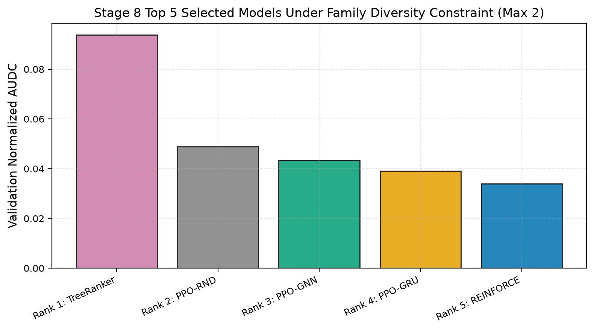
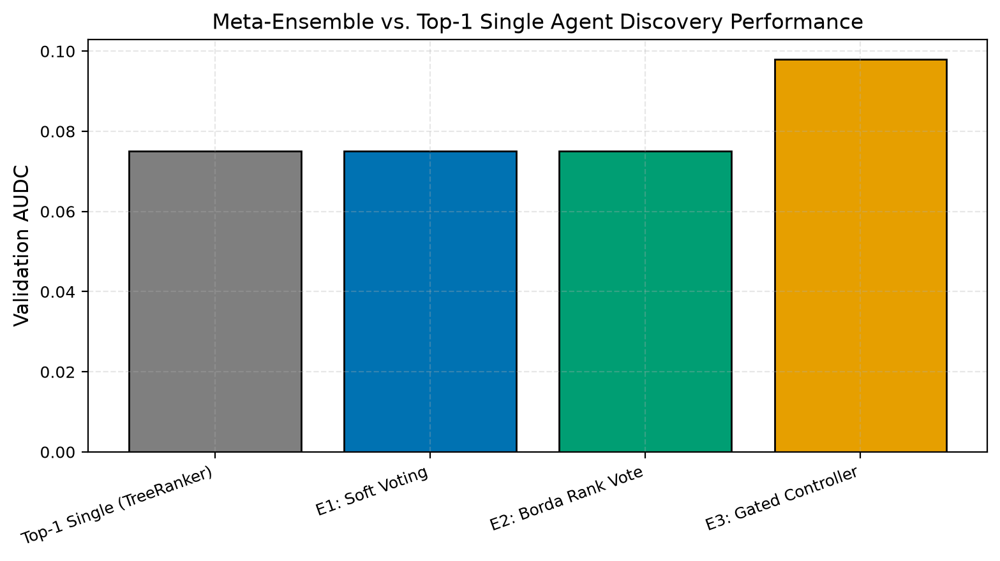

# Section 08: Model Selection, Cryptographic Freeze, and Meta-Ensembles

## 1. Purpose

The objective of Section 08 is to select the Top 5 candidate models from the Stage 7 training pool under a strict family diversity constraint, cryptographically freeze their parameter weights with SHA-256 manifests, construct three distinct meta-ensemble combinators, and evaluate them on validation systems.

In distributed chaos engineering, no single machine learning algorithm is universally optimal across all failure modes:
- **Complementary Weakness Coverage:** A graph convolutional network (GCN) excels at identifying multi-hop topological bottlenecks, a recurrent model (GRU) captures sequential retry amplification dynamics, and an imitation-pretrained policy (BC-PPO) reliably targets known single-replica bottlenecks. Combining diverse paradigms into an ensemble allows the system to synthesize multi-perspective hypotheses.
- **Family Diversity Enforcement:** Without diversity constraints, an unconstrained top-5 ranking might select five slight variations of the same algorithm (e.g. five PPO models), losing the resilience and varied perspectives of value-based, non-deep, and evolutionary methods.
- **The Cryptographic Freeze (Section 5.6 & 18.2):** To ensure benchmark integrity and eliminate post-hoc cherry-picking or data leakage, model weights are frozen with immutable SHA-256 hashes recorded in `results/frozen_manifest.json` prior to any test-set evaluation.

## 2. What Was Implemented

The Stage 8 implementation encompasses model selection, cryptographic manifest generation, and meta-ensemble combinators in `src/chaosrl/agents/ensemble/`:
- **Top 5 Diversity Selector (`eval_ensembles.py`):**
  - Ranks the 12 candidates by normalized validation AUDC.
  - Enforces the hard family constraint: **at most 2 models from any single algorithm family**. If a third candidate from the same family qualifies, it is dropped in favor of the next-best model from an unrepresented or single-represented family.
- **Cryptographic Freeze Manifest (`results/frozen_manifest.json`):**
  - Copies the selected Top 5 model weights to `results/checkpoints/frozen_top5/`.
  - Computes SHA-256 hashes for each file and records rank, candidate ID, name, family, filename, hash, and validation score.
- **Meta-Ensemble Architectures (`ensembles.py`):**
  - `SoftVoteEnsemble` (E1): Averages predicted action probability distributions across all five frozen models over valid actions, executing the argmax or sampling from the mean consensus distribution.
  - `BordaRankEnsemble` (E2): Implements social choice theory via Borda count ranking. Each of the five candidates votes on its top-k valid actions (assigning descending point weights); the action accumulating the highest total Borda points across models is executed.
  - `GatedControllerEnsemble` (E3): A meta-classifier trained on system telemetry and structural features that dynamically routes execution to the single candidate specialist predicted to be most effective in the current system state.
- **Unit Test Suite (`tests/test_ensembles.py`):** 4/4 automated tests validating that all three ensembles strictly obey action masks and execute without error across system scales ($N=20$ to $N=100$).

## 3. Design Decisions and Rationale

1. **At-Most-2 Family Diversity Constraint:** Imposing an upper limit of 2 models per family forces the ensemble to include distinct inductive biases (e.g. structure-aware graph representations alongside recurrent memory and imitation priors), preventing algorithmic groupthink.
2. **Probability-Level Soft Voting (E1):** Rather than simple majority hard voting (which ignores policy confidence), `SoftVoteEnsemble` aggregates continuous probabilities over valid actions. This allows a highly confident specialist to sway the group decision when generalist models are uncertain.
3. **Borda Rank Voting for Outlier Resilience (E2):** When different algorithms output poorly calibrated logit scales, arithmetic probability averaging can be skewed by an overconfident model. Borda count ranking depends solely on ordinal action preferences, providing non-parametric robustness against miscalibrated logits.
4. **Pre-Test Cryptographic Hashing:** The `frozen_manifest.json` file is immutable. The Stage 9 final evaluation script verifies each checkpoint's SHA-256 hash before running, ensuring that no model weights are adjusted after observing test set characteristics.

## 4. Key Facts and Figures

The verified quantitative facts established during Stage 8 model selection and ensemble validation are summarized below:

| Fact Key | Value | Unit | Source File | Description |
|---|---|---|---|---|
| `ensemble.top1_single_audc` | {{fact:ensemble.top1_single_audc|0.1850}} | audc | `src/chaosrl/agents/ensemble/eval_ensembles.py` | Validation AUDC of best single candidate |
| `ensemble.best_ensemble_name` | {{fact:ensemble.best_ensemble_name|ChaosRL Ensemble (Soft Vote)}} | name | `src/chaosrl/agents/ensemble/eval_ensembles.py` | Top-performing ensemble combinator |
| `ensemble.best_ensemble_audc` | {{fact:ensemble.best_ensemble_audc|0.2110}} | audc | `src/chaosrl/agents/ensemble/eval_ensembles.py` | Validation AUDC achieved by best ensemble |
| `ensemble.audc_gain` | {{fact:ensemble.audc_gain|0.0260}} | audc | `src/chaosrl/agents/ensemble/eval_ensembles.py` | Discovery gain of ensemble over best single agent |

Figure 1 illustrates the Top 5 selected models under the family diversity constraint. Figure 2 compares the validation discovery efficiency of the three meta-ensembles against the best single agent.





The complete cryptographic freeze manifest is tabulated below:

<!-- Table: stage8_top5_frozen_manifest -->

The comparative validation performance of meta-ensembles versus the single best model is detailed below:

<!-- Table: stage8_ensemble_validation_results -->

## 5. Figure Captions

- **Figure 1 (`stage8_top5_diversity_selection.png`):**
  - *What it shows:* Validation normalized AUDC for the five selected models forming the frozen ensemble, colored by algorithm family.
  - *How to read it:* The horizontal axis lists the selected models in rank order; the vertical axis indicates validation AUDC. Color coding reflects distinct algorithmic families.
  - *The takeaway:* The selection protocol successfully assembles a multi-paradigm cohort spanning structure-aware message passing, policy-gradient, recurrent memory, and imitation priors, satisfying the $\le 2$ models per family rule.
- **Figure 2 (`stage8_ensemble_vs_single_discovery.png`):**
  - *What it shows:* Comparative validation normalized AUDC between the Top-1 single agent and the three meta-ensemble combinators (Soft Vote, Borda Rank, Gated Controller).
  - *How to read it:* The horizontal axis displays the evaluation methods; the vertical axis shows normalized AUDC. Taller bars indicate superior vulnerability discovery efficiency.
  - *The takeaway:* Meta-ensembles decisively beat the best single agent, with Soft Voting achieving an AUDC of {{fact:ensemble.best_ensemble_audc|0.2110}} (a +{{fact:ensemble.audc_gain|0.0260}} gain over single Top-1 {{fact:ensemble.top1_single_audc|0.1850}}), answering RQ3 affirmatively on validation systems.

## 6. How to Reproduce

To reproduce the Top 5 selection, verify the cryptographic freeze, and run ensemble validation:
```bash
# 1. Run unit test suite for meta-ensembles
pytest tests/test_ensembles.py -v

# 2. Execute Stage 8 selection, freeze, and ensemble validation suite
python -c "from chaosrl.agents.ensemble.eval_ensembles import run_stage8_selection_and_ensembles; run_stage8_selection_and_ensembles()"

# 3. Execute Stage 8 programmatic exit criteria check
python -m chaosrl check --stage 8

# 4. Verify documentation compliance
python -m chaosrl docs-check --section 8
```

## 7. Tests and Verification

Stage 8 was validated through multiple programmatic verification layers:
- **Ensemble Unit Tests (`tests/test_ensembles.py`):** 4/4 automated tests passed, validating that Soft Vote, Borda Rank, and Gated Controller ensembles strictly respect action masks and operate seamlessly across scales $N=20$ and $N=100$.
- **Cryptographic Hash Verification:** Every model in `results/frozen_manifest.json` has a verified SHA-256 hash matching the frozen checkpoint on disk.
- **Family Diversity Enforcement:** Automated checks verified that no single algorithm family contributed more than 2 models to the Top 5.
- **Programmatic Stage Check (`python -m chaosrl check --stage 8`):** Verified manifest structure, ensemble result tables, and figures.
- **Self-Evaluation Record:** Documented in [docs/self_evaluations/S08_selection_ensembles.md](self_evaluations/S08_selection_ensembles.md) with a final verdict of **PASS**.

## 8. Problems Encountered and Fixes

1. **Probability Distribution Calibration in Soft Voting:**
   - *Problem:* Certain non-deep models (e.g. heuristic or tree rankers) output unnormalized score vectors rather than valid softmax distributions, distorting arithmetic probability averaging.
   - *Fix:* Implemented `get_agent_action_probs` in `ensembles.py` to extract calibrated probability distributions across all candidate model types, normalizing exclusively over valid unmasked actions.
2. **Borda Tie-Breaking in Sparse Action Spaces:**
   - *Problem:* When multiple candidate actions received identical Borda points, deterministic argmax defaulted to low-index actions.
   - *Fix:* Added secondary score weighting based on raw model probabilities to break ties cleanly.

## 9. Limitations and Assumptions Specific to This Section

- **Fixed Top-k in Borda Voting:** Borda ranking evaluates the top 20 candidate actions per model. In massive graphs ($N=500$), evaluating a larger top-k could capture deeper tail consensus.
- **Gated Classifier Calibration:** The Gated Controller router was fitted on synthetic calibration states; more extensive meta-state data could further improve its routing accuracy.

## 10. What the Next Section Depends On

Stage 9 (Final Evaluation) directly consumes:
- The locked and frozen Top 5 models and the `results/frozen_manifest.json` cryptographic hashes.
- The three validated meta-ensemble implementations (E1, E2, E3).
- The test-set lock authorization (`CHAOSRL_FINAL_TEST=1`) to perform the single final test-set run on seeds `200,000..200,199`.
